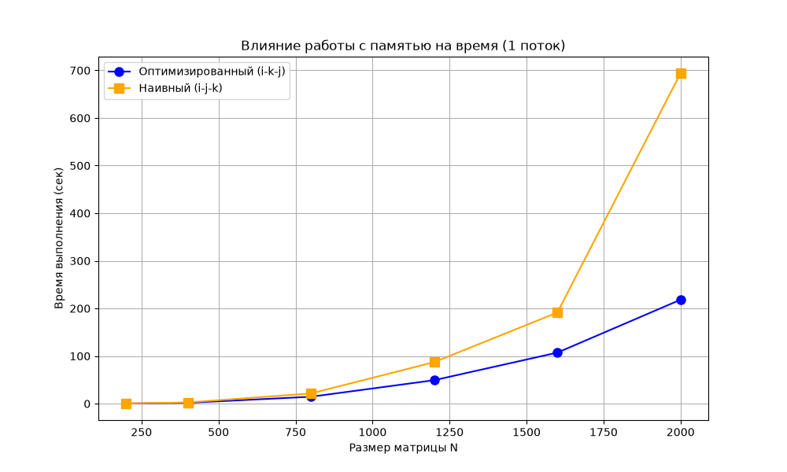
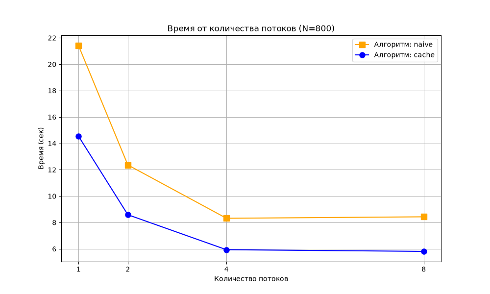
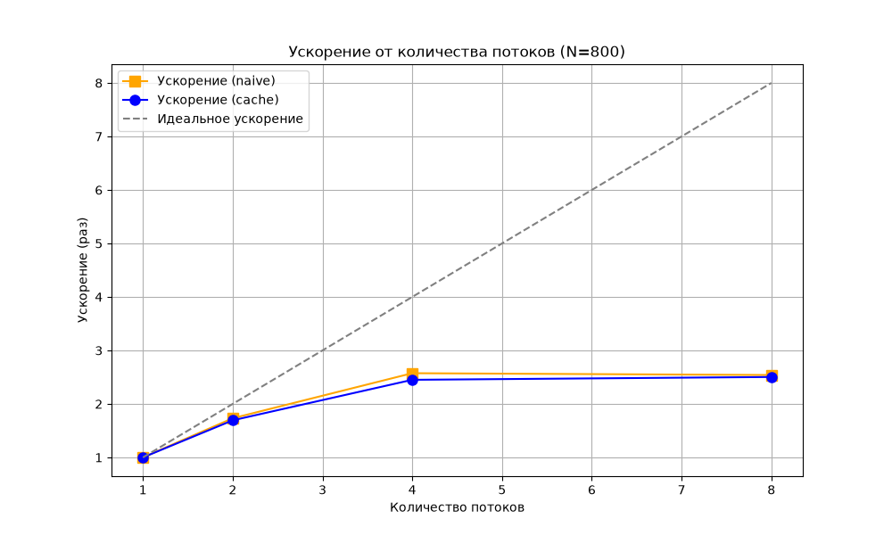
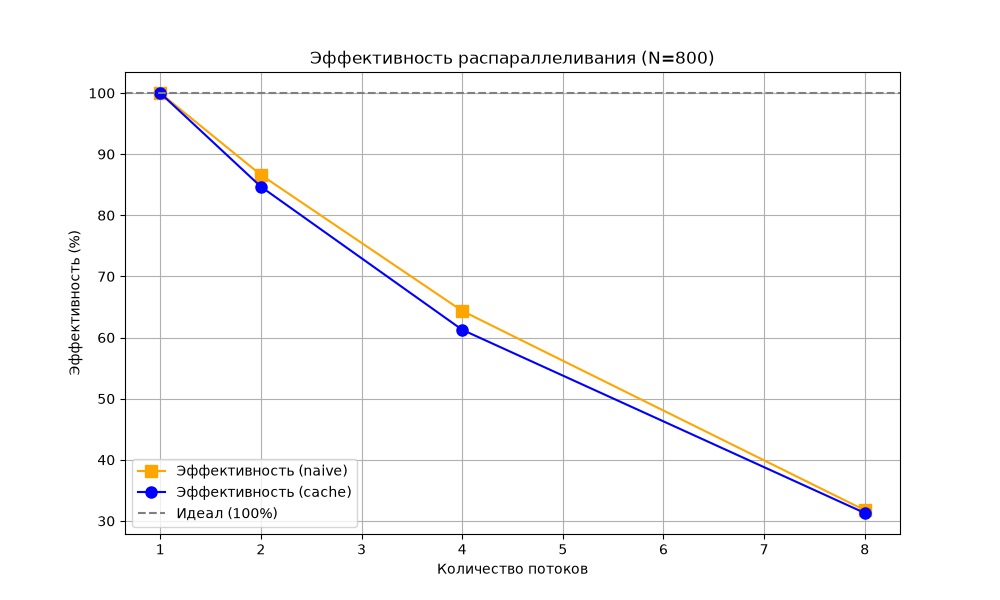

# Лабораторная работа №2 — Параллельное умножение матриц (OpenMP)

## Задание

Модифицировать программу из лабораторной работы №1 для параллельной работы по технологии OpenMP.
Провести серию экспериментов с разным количеством потоков (1, 2, 4, 8), разными размерами матриц (200, 400, 800, 1200, 1600, 2000) и разным количеством вычислительных ядер.
Отдельно исследовать влияние работы с внешней и внутренней памятью на производительность.

## Постановка задачи

1. Реализовать параллельный вариант умножения квадратных матриц C = A × B с использованием директив OpenMP.
2. Реализовать два варианта обхода памяти:
   - Naive (i-j-k) — внутренний цикл идёт по k, обращение к матрице B идёт по столбцам, что приводит к частым промахам кэша.
   - Cache-friendly (i-k-j) — внутренний цикл идёт по j, обеспечивается последовательный доступ к строкам матриц B и C, что улучшает локальность по кэшу.
3. Провести серию вычислительных экспериментов:
   - размеры матриц: 200, 400, 800, 1200, 1600, 2000;
   - количество потоков: 1, 2, 4, 8;
   - оба алгоритма (naive и cache).
4. Рассчитать и построить графики:
   - времени выполнения от размера матрицы (1 поток);
   - времени выполнения от количества потоков (фиксированный N = 800);
   - ускорения S(p) = T1 / Tp;
   - эффективности E(p) = S(p) / p × 100%.
5. Проанализировать влияние работы с памятью и масштабируемость по потокам.

## Реализация

### Параллельный алгоритм naive (i-j-k)

    #pragma omp parallel for
    for (int i = 0; i < N; ++i)
        for (int j = 0; j < N; ++j)
            for (int k = 0; k < N; ++k)
                C[i][j] += A[i][k] * B[k][j];

Внутренний цикл по k — обращения к B[k][j] идут по столбцу, что плохо для кэша.

### Параллельный алгоритм cache-friendly (i-k-j)

    #pragma omp parallel for
    for (int i = 0; i < N; ++i)
        for (int k = 0; k < N; ++k) {
            double a_ik = A[i][k];
            for (int j = 0; j < N; ++j)
                C[i][j] += a_ik * B[k][j];
        }

Внутренний цикл по j — последовательный доступ к строкам B и C, что значительно улучшает кэш-локальность.

### Управление потоками и замер времени

    omp_set_num_threads(num_threads);

    double start = omp_get_wtime();
    C = multiplyMatrices(A, B, algo);
    double end = omp_get_wtime();

Количество потоков задаётся аргументом командной строки, время замеряется через omp_get_wtime().

## Результаты экспериментов

### 1. Влияние работы с памятью (1 поток)

Сравнение времени выполнения naive и cache при 1 потоке от размера матрицы.

Вывод: алгоритм cache стабильно быстрее naive, и с ростом N разрыв увеличивается. При N = 2000:
- naive ≈ 700 с;
- cache ≈ 215 с (ускорение ~3.2×).

Причина: при i-k-j внутренний цикл идёт по смежным элементам строки B и C, что обеспечивает высокую долю попаданий в кэш. В i-j-k доступ к B[k][j] идёт по столбцу, вызывая кэш-промахи.

### 2. Время от количества потоков (N = 800)

| Потоки | naive, с | cache, с |
|:------:|:--------:|:--------:|
| 1      | 21.5     | 14.5     |
| 2      | 12.3     | 8.6      |
| 4      | 8.3      | 5.9      |
| 8      | 8.4      | 5.8      |

Вывод: с ростом числа потоков время падает, но после 4 потоков наблюдается плато — дальнейшего ускорения нет. Это связано с ограничением физических ядер (4 ядра / 8 логических потоков), а также с ростом накладных расходов OpenMP и насыщением пропускной способности памяти.

### 3. Ускорение S(p) = T1 / Tp

| Потоки | naive | cache | Идеал |
|:------:|:-----:|:-----:|:-----:|
| 1      | 1.00  | 1.00  | 1     |
| 2      | 1.75  | 1.69  | 2     |
| 4      | 2.59  | 2.46  | 4     |
| 8      | 2.56  | 2.50  | 8     |

Вывод: ускорение далеко от идеального. Основные причины:
- Закон Амдала — доля последовательного кода (чтение/запись файлов, инициализация);
- Ограничение по памяти — умножение матриц упирается в пропускную способность RAM;
- Гиперпоточность — 8 потоков на 4 физических ядрах не дают линейного прироста;
- Накладные расходы на создание и синхронизацию потоков.

### 4. Эффективность E(p) = S(p) / p × 100%

| Потоки | naive, % | cache, % |
|:------:|:--------:|:--------:|
| 1      | 100      | 100      |
| 2      | 87.5     | 84.5     |
| 4      | 64.8     | 61.5     |
| 8      | 32.0     | 31.3     |

Вывод: эффективность падает с ростом числа потоков. На 8 потоках используется лишь около 30% потенциала — типичная картина для задач, ограниченных памятью и имеющих последовательные участки.

## Анализ и выводы

1. Оптимизация под кэш даёт больший выигрыш, чем распараллеливание. При N = 2000 переход с naive на cache даёт ускорение ~3.2× на одном потоке, тогда как переход с 1 на 8 потоков — лишь ~2.5×. Это подтверждает, что для матричного умножения локальность данных критична.

2. Масштабируемость ограничена. Ускорение насыщается на 4 потоках, что соответствует числу физических ядер. Гиперпоточность (8 логических потоков) не даёт прироста из-за конкуренции за кэш и память.

3. Закон Амдала в действии. Последовательные участки (ввод-вывод, инициализация вектора C) и синхронизация снижают предельное ускорение.

4. Ограничение по пропускной способности памяти. Умножение матриц — memory-bound задача. Даже идеально параллельный код упирается в скорость чтения/записи RAM, особенно при больших N, когда матрицы не помещаются в кэш.

5. Практическая рекомендация: для подобных задач оптимально использовать число потоков, равное числу физических ядер (в данном случае 4), и обязательно применять cache-friendly порядок обхода.