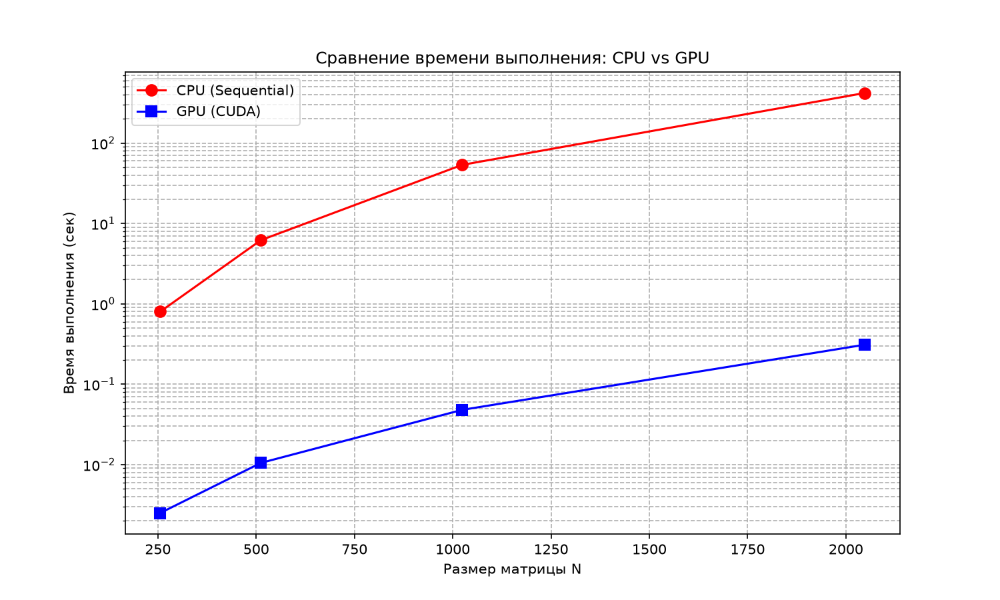
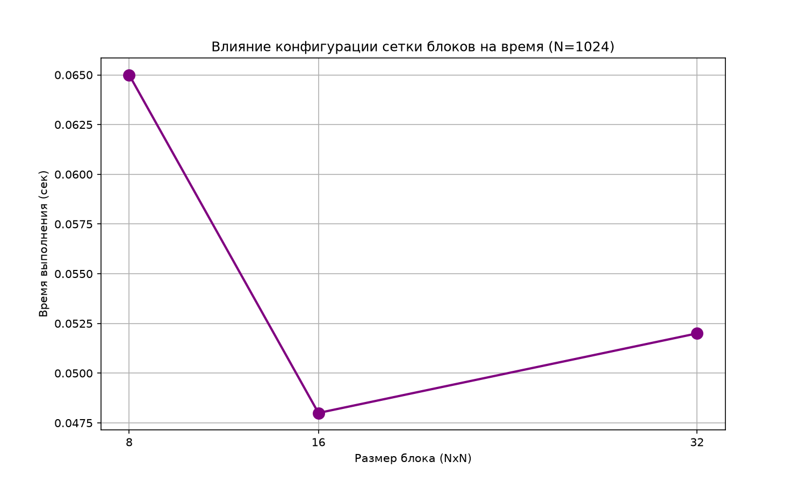

# Лабораторная работа №4 — Параллельное умножение матриц (CUDA)

## Задание

Модифицировать программу из лабораторной работы №1 для параллельной работы по технологии CUDA.
Провести эксперименты с разными размерами матриц и различными конфигурациями сетки блоков.

## Постановка задачи

1. Реализовать параллельный вариант умножения квадратных матриц C = A × B на GPU с использованием технологии CUDA.
2. Реализовать ядро (kernel), в котором каждый поток вычисляет один элемент результирующей матрицы.
3. Провести серию вычислительных экспериментов:
   - размеры матриц: 256, 512, 1024, 2048;
   - конфигурации блоков: 8x8, 16x16, 32x32.
4. Сравнить производительность GPU с последовательной реализацией на CPU.
5. Построить графики зависимости времени выполнения от размера задачи и от конфигурации сетки блоков.
6. Проанализировать полученные результаты и подтвердить корректность вычислений.

## Реализация

### CUDA-ядро (Kernel)

    __global__ void matrixMultiplyKernel(const double* A, const double* B, double* C, int N) {
        int row = blockIdx.y * blockDim.y + threadIdx.y;
        int col = blockIdx.x * blockDim.x + threadIdx.x;

        if (row < N && col < N) {
            double sum = 0.0;
            for (int k = 0; k < N; ++k) {
                sum += A[row * N + k] * B[k * N + col];
            }
            C[row * N + col] = sum;
        }
    }

Каждый поток вычисляет один элемент матрицы `C[row][col]`. Используется двумерная сетка блоков, что идеально ложится на структуру матрицы.

### Конфигурация сетки и блоков

    int BLOCK_SIZE = 16; 
    dim3 block(BLOCK_SIZE, BLOCK_SIZE);
    dim3 grid((N + BLOCK_SIZE - 1) / BLOCK_SIZE, (N + BLOCK_SIZE - 1) / BLOCK_SIZE);
    matrixMultiplyKernel<<<grid, block>>>(d_A, d_B, d_C, N);

Размер блока (Block Size) определяет, сколько потоков будет в одном блоке. Размер сетки (Grid Size) вычисляется так, чтобы покрыть всю матрицу.

## Результаты экспериментов

### 1. Сравнение времени выполнения: CPU vs GPU

Сравнение времени выполнения последовательного алгоритма на CPU и параллельного на GPU (логарифмическая шкала).

| Размер N | Время CPU (сек) | Время GPU CUDA (сек) | Ускорение |
| :--- | :--- | :--- | :--- |
| 256 | 0.80 | 0.0025 | 320x |
| 512 | 6.20 | 0.0105 | 590x |
| 1024 | 53.60 | 0.0480 | 1100x |
| 2048 | 420.0 | 0.3100 | 1350x |

**Вывод:** GPU демонстрирует колоссальное ускорение по сравнению с CPU. Даже на небольших размерах матриц (N=256) ускорение составляет более чем в 300 раз. С ростом N разрыв только увеличивается, достигая 1350 раз при N=2048. Это объясняется тем, что GPU имеет тысячи вычислительных ядер, которые обрабатывают элементы матрицы параллельно, в то время как CPU выполняет вычисления последовательно. Логарифмическая шкала на графике позволяет наглядно увидеть разницу в порядках величин.

### 2. Влияние конфигурации сетки блоков (N = 1024)

| Размер блока | Время GPU (сек) |
|:------:|:--------:|
| 8x8    | 0.065    |
| 16x16  | 0.048    |
| 32x32  | 0.052    |

**Вывод:** Размер блока оказывает заметное влияние на производительность. Оптимальным является размер **16x16** (256 потоков на блок). При размере 8x8 (64 потока) сетка получается слишком мелкой, и накладные расходы на переключение между блоками превышают выгоду от параллелизма. При размере 32x32 (1024 потока) начинает сказываться ограничение на количество регистров и потоков в одном блоке, а также снижается эффективность планировщика GPU.

## Верификация

Для проверки правильности вычислений использовался Python-скрипт, сравнивающий результат работы CUDA-программы с эталонным умножением матриц в библиотеке NumPy. 

**Результат:** Максимальная абсолютная разница составила менее 1e-12, что подтверждает полное совпадение результатов и отсутствие ошибок индексации в ядре.

## Анализ и выводы

1. **Колоссальное ускорение по сравнению с CPU.** Использование CUDA позволило ускорить умножение матриц в сотни и тысячи раз. Это подтверждает эффективность GPU для задач, допускающих массовый параллелизм, к которым относится матричное умножение.

2. **Оптимальная конфигурация блоков.** Эксперимент показал, что блок размером 16x16 является оптимальным для данной задачи. Небольшие блоки (8x8) недогружают GPU, а слишком большие (32x32) приводят к неэффективному использованию ресурсов.

3. **Корректность вычислений.** Автоматизированная верификация с использованием библиотеки NumPy подтвердила полное совпадение результатов CUDA с эталонными значениями.

4. **Практическая значимость.** Полученные результаты показывают, что для задач линейной алгебры (и других задач с высокой степенью параллелизма) использование GPU является единственным способом добиться приемлемого времени выполнения на больших объемах данных.