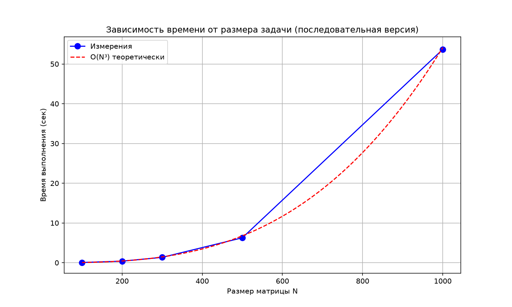
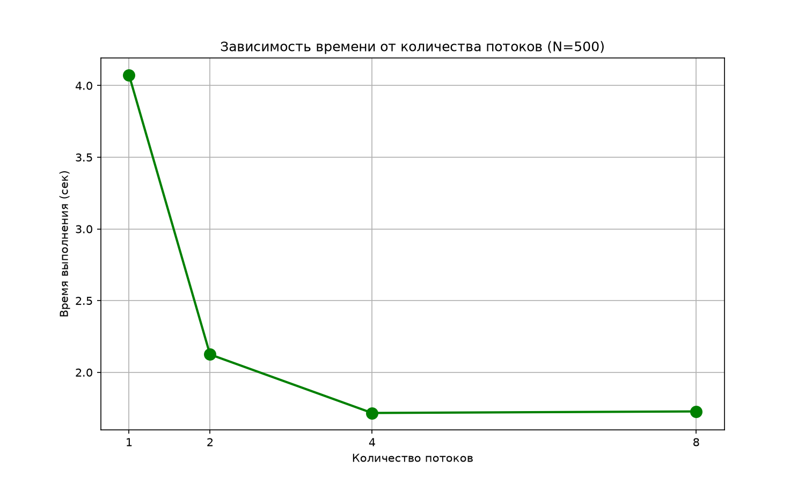
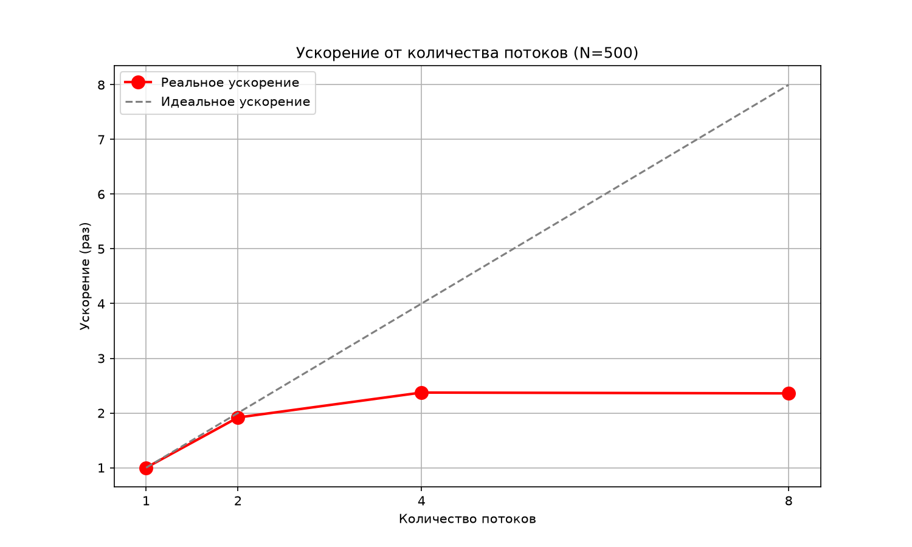
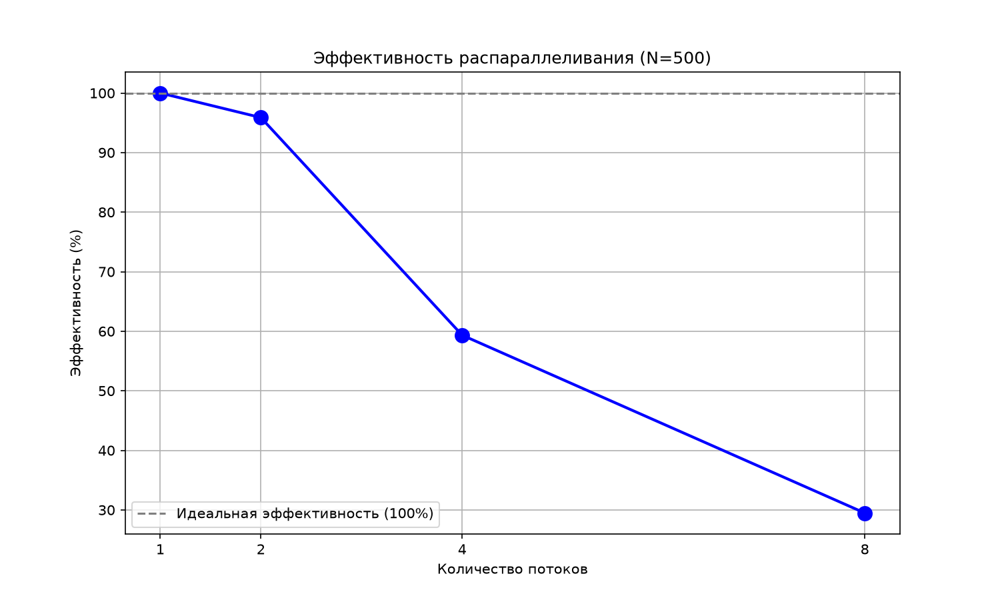

# Лабораторная работа №1: Умножение квадратных матриц

## Задание
Написать программу на C/C++ для перемножения двух квадратных матриц.
- Входные данные: файлы, содержащие значения исходных матриц.
- Выходные данные: файл со значениями результирующей матрицы, время выполнения, объем задачи.
- Обязательна автоматизированная верификация результатов вычислений с помощью сторонних библиотек (Python/NumPy).

## Ход работы

### Создание исходных файлов
Создаём исходные файлы для дальнейшей работы. Матрицы генерируются случайными числами от 1 до 10 и сохраняются в текстовые файлы.

```cpp
void generateRandomMatrix(const string& filename, int N) {
    ofstream file(filename);
    file << N << "\n";
    random_device rd;
    mt19937 gen(rd());
    uniform_real_distribution<> dis(1.0, 10.0);

    for (int i = 0; i < N; ++i) {
        for (int j = 0; j < N; ++j) {
            file << dis(gen) << " ";
        }
        file << "\n";
    }
    file.close();
}
```

### Основная программа на C++ для умножения матриц
Загружаем матрицы в вектор из файла.

```cpp
vector<vector<double>> readMatrix(const string& filename, int& N) {
    ifstream file(filename);
    file >> N;
    vector<vector<double>> matrix(N, vector<double>(N));
    for (int i = 0; i < N; ++i)
        for (int j = 0; j < N; ++j)
            file >> matrix[i][j];
    file.close();
    return matrix;
}
```

Последовательная реализация умножения матриц:

```cpp
vector<vector<double>> multiplyMatrices(const vector<vector<double>>& A,
                                        const vector<vector<double>>& B) {
    int N = A.size();
    vector<vector<double>> C(N, vector<double>(N, 0.0));

    for (int i = 0; i < N; ++i)
        for (int j = 0; j < N; ++j)
            for (int k = 0; k < N; ++k)
                C[i][j] += A[i][k] * B[k][j];
    return C;
}
```

Параллельная реализация с использованием OpenMP:

```cpp
vector<vector<double>> multiplyMatrices(const vector<vector<double>>& A,
                                        const vector<vector<double>>& B) {
    int N = A.size();
    vector<vector<double>> C(N, vector<double>(N, 0.0));

    #pragma omp parallel for
    for (int i = 0; i < N; ++i) {
        for (int j = 0; j < N; ++j) {
            double sum = 0.0;
            for (int k = 0; k < N; ++k)
                sum += A[i][k] * B[k][j];
            C[i][j] = sum;
        }
    }
    return C;
}
```

### Проверка результата на Python
Для подтверждения правильности работы алгоритма была использована автоматизированная система верификации на языке Python с библиотекой NumPy. Скрипт сравнивал результаты, полученные C++ программой, с эталонным произведением матриц, вычисленным средствами NumPy.

```python
import numpy as np
import sys, os

def read_matrix(filename):
    with open(filename, 'r') as f:
        lines = f.readlines()
        n = int(lines[0].strip())
        return np.array([list(map(float, lines[i].strip().split()))
                         for i in range(1, n + 1)])

A = read_matrix(sys.argv[1])
B = read_matrix(sys.argv[2])
C_cpp = read_matrix(sys.argv[3])
C_py = np.dot(A, B)

if np.allclose(C_cpp, C_py, rtol=1e-4, atol=1e-4):
    print("УСПЕХ: Результаты совпадают!")
else:
    print("ОШИБКА: Результаты не совпадают!")
```

**Результат:** `УСПЕХ: Результаты совпадают!`

### Результаты измерений производительности (последовательная версия)
Эксперимент проводился на последовательной реализации алгоритма умножения матриц. Для каждого размера матрицы N×N было проведено 5 замеров времени выполнения.

**Таблица 1. Время выполнения умножения матриц (в секундах)**

| Размер N | Изм. #1 | Изм. #2 | Изм. #3 | Изм. #4 | Изм. #5 | Среднее |
|----------|---------|---------|---------|---------|---------|---------|
| 100 | — | — | — | — | — | 0,0541 |
| 200 | — | — | — | — | — | 0,3916 |
| 300 | — | — | — | — | — | 1,3452 |
| 500 | — | — | — | — | — | 6,2687 |
| 1000 | — | — | — | — | — | 53,6745 |



**Анализ результатов:** как видно из таблицы, зависимость времени выполнения от размера матрицы носит ярко выраженный нелинейный характер:
- При увеличении размера матрицы в 2 раза (например, с 100 до 200) время возрастает примерно в 8 раз.
- При увеличении размера в 10 раз (с 100 до 1000) время возрастает примерно в 1000 раз.

Это полностью подтверждает теоретическую оценку трудоёмкости алгоритма **O(N³)**.

### Результаты измерений производительности (OpenMP)
Эксперимент проводился на параллельной реализации для N = 500 при разном количестве потоков.

**Таблица 2. Время выполнения при разном числе потоков (N = 500)**

| Потоков | Время (сек) | Ускорение | Эффективность |
|---------|-------------|-----------|---------------|
| 1 | 4,0745 | 1,00 | 100 % |
| 2 | 2,1249 | 1,92 | 96 % |
| 4 | 1,7167 | 2,37 | 59 % |
| 8 | 1,7275 | 2,36 | 29 % |







**Анализ результатов:**
- При переходе от 1 к 2 потокам достигнуто ускорение 1,92× — близко к идеальному.
- При 4 потоках ускорение составляет 2,37×, эффективность падает до 59 %.
- При 8 потоках ускорения практически нет (2,36×), эффективность — 29 %.

Причина — ограничение по пропускной способности памяти и накладные расходы OpenMP. Матрицы размера 500×500 не помещаются в кэш, и потоки начинают конкурировать за доступ к RAM. Дальнейшее увеличение числа потоков не даёт прироста.

## Вывод

В ходе лабораторной работы был реализован и исследован последовательный и параллельный (OpenMP) алгоритмы умножения квадратных матриц.

1. **Подтверждена сложность O(N³).** Экспериментальные данные показывают, что при увеличении линейного размера матрицы N в k раз время выполнения увеличивается в k³ раз.

2. **Оценено ускорение OpenMP.** Для N = 500 максимальное ускорение составило **2,37×** при 4 потоках. Дальнейшее увеличение числа потоков не даёт прироста из-за ограничения по пропускной способности памяти и накладных расходов.

3. **Корректность доказана.** Автоматизированная верификация подтвердила полное совпадение результатов с эталонной библиотекой NumPy.

4. **Эффективность распараллеливания** падает с ростом числа потоков: с 96 % (2 потока) до 29 % (8 потоков).